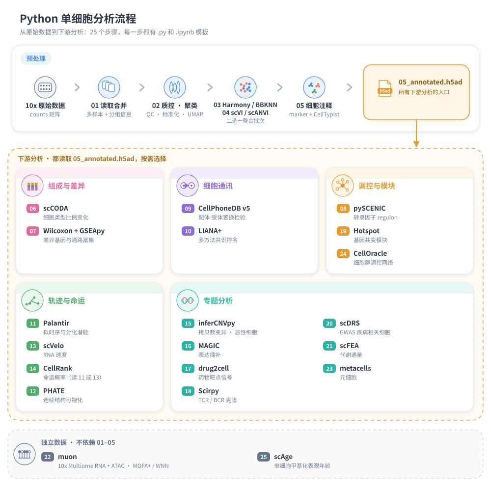
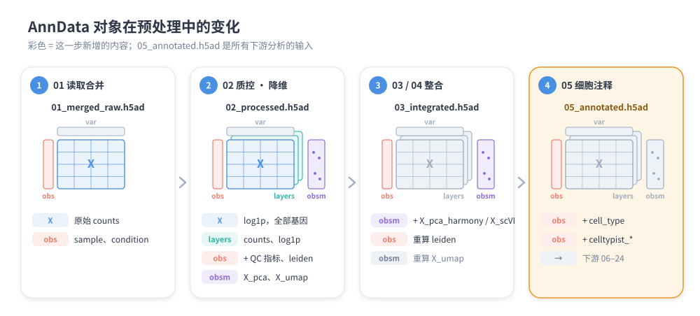
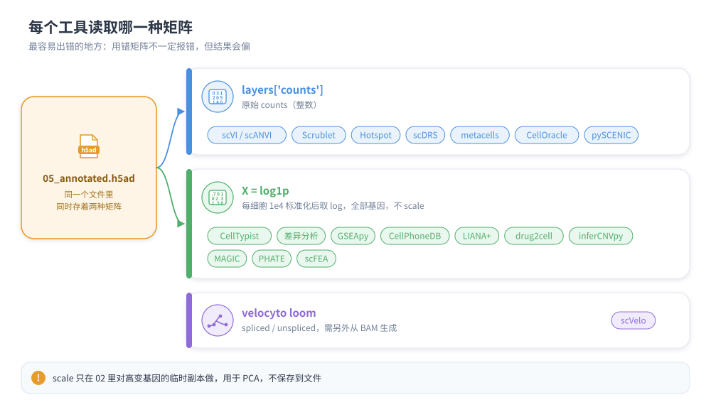
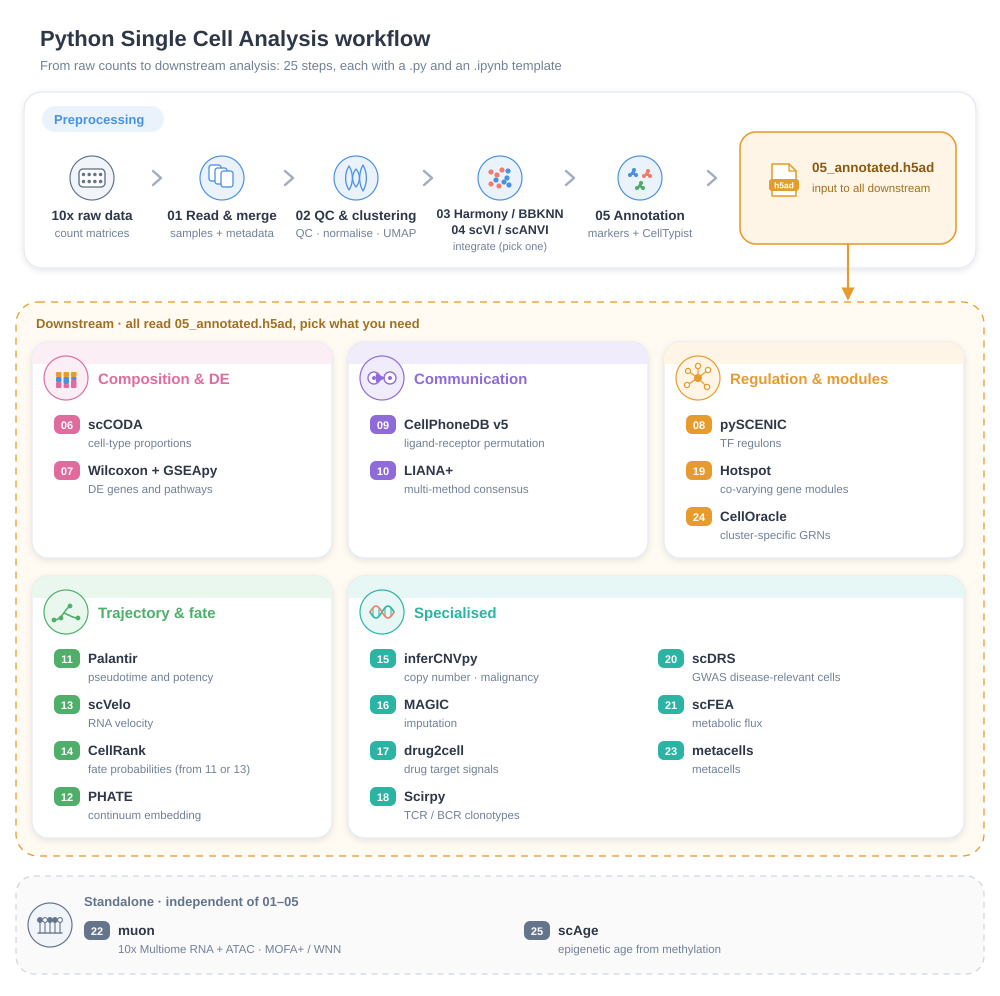
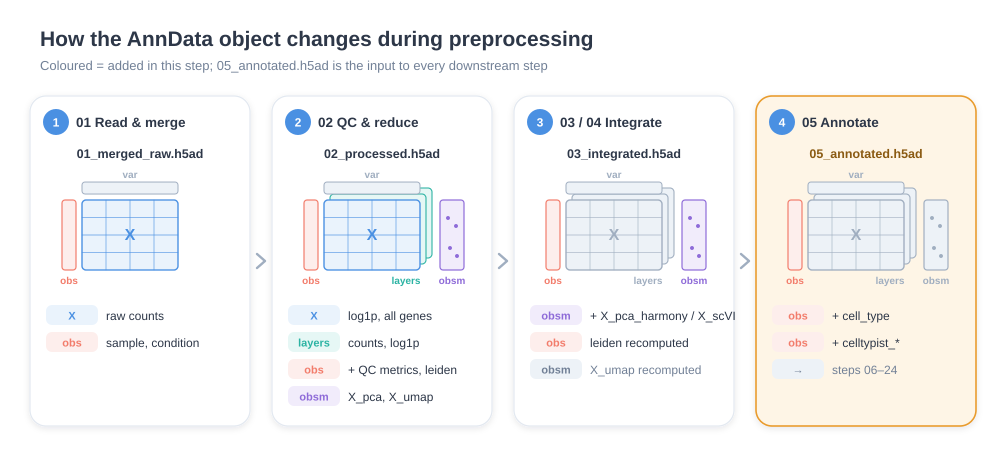
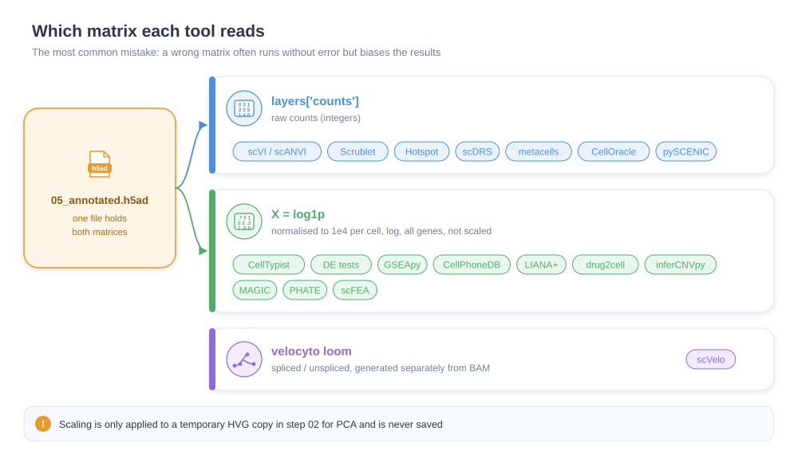
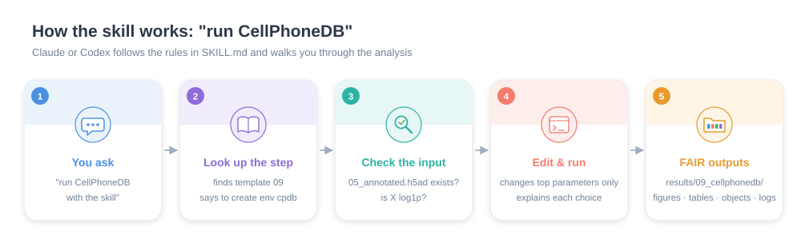

<div align="center">

# Python Single Cell Analysis Skill

**在 Python 中完成单细胞转录组全流程分析的模板库 + AI skill**
**End-to-end single-cell RNA-seq analysis in Python — templates + an AI skill**


[中文](#中文) · [English](#english)

</div>

---

## 中文

### 这是什么

一套从数据读取到基因调控网络的 **Python 单细胞转录组分析模板**，共 25 个步骤，同时也是一个 **Claude skill**（`SKILL.md`）。

- **每一步一个模板**：`.py` 给 Spyder 用，`.ipynb` 给 Jupyter 用，两种内容完全相同。
- **每个模板开头都写清楚**：这份代码做什么、在流程中的位置、用哪个 conda 环境、输入数据、输出结果、怎么解读结果、注意事项。
- **每个代码块开头三行注释**：步骤、输入、输出。参数全部集中在脚本顶部，用大写变量名。
- **按工具拆分 conda 环境（共 12 个）**：避免不同工具互相要求不同版本的包，每个环境都有 `envs/*.yml`，一条命令就能装好。
- **输出按 FAIR 原则组织**：每个步骤一个结果文件夹，图、表、对象、日志分开存放，文件名带步骤号；自动记录参数和全部包版本，并生成 README。
- **作为 Claude skill 使用时**：Claude 会先提示这一步需要哪个环境、要装哪些包，检查输入数据状态，再基于模板改参数。

这个项目是 Yueling Peng 总结的 Python 单细胞分析代码，现在整理成 skill。目的是在 Python 里完整地做完单细胞分析的各个步骤，不需要再切换到 R。

R 里的 Seurat 从 v4 升级到 v5 后，对象结构变了（Assay5、layers），不少依赖 Seurat 对象的下游包还不兼容 v5，环境很难维护。

这里改用 scanpy / AnnData 体系，从质控、整合、注释到细胞通讯、拟时序、调控网络都在 Python 中完成。

### 分析流程



### 步骤总表

| 步骤 | 模板 | conda 环境 | 做什么 |
|---|---|---|---|
| 01 | `01_read_data` | sc-core | 读取 10x 数据，合并样本，加入样本分组信息 |
| 02 | `02_qc_cluster` | sc-core | 质控、去双细胞、标准化、高变基因、PCA、Leiden 聚类、UMAP、marker |
| 03 | `03_integrate_harmony_bbknn` | sc-core | 多样本整合：Harmony / BBKNN / ingest |
| 04 | `04_integrate_scvi` | sc-scvi | scVI / scANVI 整合 + scib-metrics 评估 |
| 05 | `05_annotate` | sc-core | marker 手动注释 + CellTypist 自动注释 |
| 06 | `06_composition_sccoda` | sc-sccoda | 细胞组成变化（scCODA） |
| 07 | `07_de_gsea_gseapy` | gseapy | 条件间差异基因 + GSEA prerank + Enrichr |
| 08 | `08a` → `08b_pyscenic` → `08c` | sc-core → pyscenic → sc-core | 转录因子调控网络（pySCENIC） |
| 09 | `09_ccc_cellphonedb` | cpdb | 细胞通讯（CellPhoneDB v5） |
| 10 | `10_ccc_liana` | liana | 细胞通讯多方法共识（LIANA+） |
| 11 | `11_trajectory_palantir` | sc-palantir | 拟时序、分化潜能、命运概率（Palantir） |
| 12 | `12_embedding_phate` | sc-core | PHATE 降维可视化 |
| 13 | `13_velocity_scvelo` | sc-velo | RNA velocity（scVelo） |
| 14 | `14_fate_cellrank` | sc-palantir / sc-velo | 终末状态、命运概率、谱系驱动基因（CellRank） |
| 15 | `15_cnv_infercnvpy` | sc-core | 拷贝数变异推断，区分恶性/正常细胞 |
| 16 | `16_impute_magic` | sc-core | MAGIC 表达插补 |
| 17 | `17_drug2cell` | sc-core | 细胞类型特异的药物靶点信号 |
| 18 | `18_tcr_bcr_scirpy` | sc-multi | TCR / BCR 免疫受体库（Scirpy） |
| 19 | `19_modules_hotspot` | sc-core | 细胞类型内的基因模块（Hotspot） |
| 20 | `20_disease_scdrs` | sc-core | GWAS 疾病相关细胞（scDRS） |
| 21 | `21a` → `21_metabolism_scfea.sh` | sc-core → scFEA | 代谢通量（scFEA） |
| 22 | `22_multiome_muon` | sc-multi | 10x Multiome RNA + ATAC 整合（muon、MOFA+、WNN） |
| 23 | `23_metacells` | sc-metacell | 元细胞（metacells） |
| 24 | `24_grn_celloracle` | Docker | 按细胞群构建 GRN（CellOracle） |
| 25 | `25_methylation_scage` | sc-core | 单细胞甲基化表观年龄（scAge，非转录组） |

### 每一步详解

点开每一步，可以看到这份代码做什么、输入、输出、怎么解读，内容与模板文件开头的说明一致。

<details>
<summary><b>01 读取单细胞数据并合并样本</b></summary>

**这份代码做什么**

把每个样本的 Cell Ranger 输出（10x 三件套）读进来，合并成一个 AnnData 对象，  
并把样本分组信息（condition 等）写到每个细胞上。这是整个流程的起点，不做任何过滤和标准化。  
流程：逐个读取样本 → 合并（细胞名加样本后缀防重复）→ 合并样本元数据 → 保存  

**在流程中的位置**：起点 → 下游 02_qc_cluster

**运行环境**：sc-core（课程 ps6 多种格式读取、ps7 多样本合并）

**输入数据**

- 每个样本一个 10x 文件夹：matrix.mtx.gz、features.tsv.gz、barcodes.tsv.gz（路径写在 SAMPLES）
- data/sample_info.csv：每个样本一行，第一列 sample（与 SAMPLES 的名字一致），其余列是样本信息，至少要有 condition，可加 batch、sex 等

**输出结果**：都在 results/01_read_data/

- objects/01_merged_raw.h5ad：X = 原始 counts；obs 里有 sample 和 sample_info.csv 的全部列
- tables/01_cells_per_sample.csv：每个样本读入的细胞数
- logs/、README.md：运行参数和包版本

**怎么解读**

- 看 cells_per_sample：每个样本的细胞数应与 Cell Ranger 报告（Estimated Number of Cells）一致；某个样本明显偏少要回查测序质量
- 运行时打印的 obs 汇总表：确认每个样本的 condition 写对了，后面 06、07 的组间比较都靠它

**注意**

- GEO 下载的文件常带前缀（如 GSM123_matrix.mtx.gz），用 prefix= 参数或改名为标准三件套
- 其他格式（h5、h5ad、csv、loom）的读法在「其他格式」块里，替换读取块即可

</details>

<details>
<summary><b>02 质控、标准化、高变基因、PCA、聚类、UMAP、marker 基因</b></summary>

**这份代码做什么**

对合并后的原始数据做 scanpy 标准预处理：去掉低质量细胞和双细胞，标准化，降维聚类，  
并找出每个群的 marker 基因，为后面的整合和注释做准备。  
流程：QC 指标 → 看图定阈值 → 过滤 → Scrublet 去双细胞 → 标准化 + log1p → 高变基因 → PCA → 邻居图 → Leiden 聚类 → UMAP → marker  

**在流程中的位置**：上游 01 → 本步 → 下游 03（Harmony/BBKNN）或 04（scVI）

**运行环境**：sc-core（课程 ps2 scanpy 标准流程、ps7）

**输入数据**

- results/01_read_data/objects/01_merged_raw.h5ad（X = 原始 counts，obs['sample']）

**输出结果**：都在 results/02_qc_cluster/

- objects/02_processed.h5ad：X = log1p 标准化（全部基因，未 scale）；layers['counts'] = 原始 counts；layers['log1p'] = 同 X； obs 有 QC 指标、predicted_doublet、leiden；obsm 有 X_pca、X_umap
- figures/：02_qc_violin_by_sample、02_qc_scatter_counts_genes、02_hvg、02_pca_variance_ratio、02_umap_leiden_sample、02_markers_dotplot_leiden（各有 .pdf 和 .png）
- tables/：02_qc_cells_kept.csv（每个样本过滤前后细胞数）、02_doublets_per_sample.csv、02_markers_leiden.csv

**怎么解读**

- QC 小提琴图：n_genes_by_counts 过低 = 空液滴或碎片，过高 = 可能是双细胞；pct_counts_mt 高 = 细胞破损。阈值看完图再改顶部参数
- qc_cells_kept 表：某个样本被过滤掉的比例远高于其他样本，说明该样本质量差，需要单独检查
- 双细胞比例一般随上样细胞数增加，约 1–8%
- PCA 方差图：曲线变平的拐点之后 PC 贡献很小，N_PCS 取拐点附近
- UMAP 按 sample 上色：如果样本各自成团，说明有批次效应，下一步要整合
- marker dotplot：点大小 = 群内表达该基因的细胞比例，颜色 = 平均表达；用来判断每个 leiden 群是什么细胞

**注意**

- 阈值（MIN_GENES、MAX_PCT_MT 等）因组织而异，不要照抄默认值；小鼠线粒体前缀用 mt-

</details>

<details>
<summary><b>03 多样本整合：Harmony（首选）/ BBKNN / ingest</b></summary>

**这份代码做什么**

去除样本之间的批次效应，让同一种细胞不管来自哪个样本都聚在一起，然后重新聚类和画 UMAP。  
提供三种方法，只选一种运行：   A Harmony：在 PCA 空间里校正批次（最常用） B BBKNN：构建批次平衡的邻居图，不改 PCA C ingest：有已经注释好的参考数据时，把参考的标签和 UMAP 投到新数据上

**在流程中的位置**：上游 02 → 本步 → 下游 05_annotate（与 04 scVI 二选一）

**运行环境**：sc-core（课程 ps7）

**输入数据**

- results/02_qc_cluster/objects/02_processed.h5ad（需要 obsm['X_pca']、obs['sample']）
- 方法 C 还需要一份已注释的参考 h5ad

**输出结果**：都在 results/03_integrate/

- objects/03_integrated.h5ad：obsm['X_pca_harmony']（方法 A），重算的 leiden 和 X_umap
- figures/：03_umap_before_integration、03_umap_after_harmony（或 bbknn / ingest）、03_markers_dotplot_leiden
- tables/：03_markers_leiden.csv、03_cells_per_cluster_sample.csv（每个群里各样本的细胞数）

**怎么解读**

- 整合前后 UMAP 对比：整合后按 sample 上色应混在一起，按 marker 上色仍然分开
- 同一细胞类型仍按样本拆开 = 校正不足；不同细胞类型被糊在一起 = 校正过度
- cells_per_cluster_sample 表：某个群只来自一个样本，要判断是批次残留还是真实的样本特异细胞群（例如只在处理组出现的状态）

</details>

<details>
<summary><b>04 scVI / scANVI 整合 + scib-metrics 评估</b></summary>

**这份代码做什么**

用深度生成模型 scVI 从原始 counts 学习去掉批次效应的低维表示（X_scVI），再聚类和画 UMAP。  
已有部分细胞标签时可以用 scANVI 进一步微调；有标签时还可以用 scib-metrics 定量比较几种整合结果。  
流程：取高变基因 → 训练 scVI → 看训练曲线 → 潜在空间聚类/UMAP →（可选）scANVI →（可选）scib 评估 → 保存  

**在流程中的位置**：上游 02 → 本步 → 下游 05_annotate（与 03 二选一，05 的 IN_FILE 改成本步输出）

**运行环境**：sc-scvi（PyTorch；课程 ps10）

**输入数据**

- results/02_qc_cluster/objects/02_processed.h5ad：layers['counts']（必须是原始 counts）、obs['sample']；scANVI / scib 还需要 obs['cell_type']

**输出结果**：都在 results/04_scvi/

- objects/04_scvi.h5ad：obsm['X_scVI']（可选 X_scANVI）、leiden、X_umap
- objects/04_scvi_model/：训练好的模型，可重新加载，不用再训练
- figures/：04_training_elbo、04_umap_scvi_sample_leiden、（可选）04_scib_results
- tables/：04_cells_per_cluster_sample.csv、（可选）04_scib_metrics.csv

**怎么解读**

- 训练曲线：ELBO 应平稳下降并收敛；验证集曲线明显回升 = 过拟合，可减少 train() 的 max_epochs
- UMAP：按 sample 混合、按细胞类型分开 = 整合良好
- scib 表：Batch correction 分数高 = 批次去得干净；Bio conservation 分数高 = 生物差异保留得好；两者要一起看，X_pca 是未整合的基线

**注意**

- 没有 GPU 也能跑，但细胞多时较慢

</details>

<details>
<summary><b>05 细胞类型注释：marker 手动注释 + CellTypist 自动注释交叉核对</b></summary>

**这份代码做什么**

给每个聚类群命名细胞类型。先看已知 marker 基因在各群的表达，再用 CellTypist 预训练模型自动注释，  
两者对照后手动写出 群 → 细胞类型 的对照表，生成后续所有分析都要用的 obs['cell_type']。  
流程：marker dotplot → CellTypist 自动注释 → 与聚类对照 → 手动填写对照表 → 注释结果作图 → 保存  

**在流程中的位置**：上游 03 或 04 → 本步 → 下游 06–24 全部分析（都读 05_annotated.h5ad）

**运行环境**：sc-core（课程 ps2/ps6 手动注释、ps9 CellTypist）

**输入数据**

- results/03_integrate/objects/03_integrated.h5ad（或 02 / 04 的结果）；X = log1p（每细胞总量 1e4，全部基因）
- 顶部 MARKERS：你的组织里各细胞类型的已知 marker（数据里没有的基因会自动去掉并打印出来）
- CellTypist 模型：第一次运行会联网下载

**输出结果**：都在 results/05_annotate/

- objects/05_annotated.h5ad：obs['cell_type']（最终注释）、obs['celltypist_*']（自动注释和置信度）
- figures/：05_markers_dotplot_leiden、05_umap_celltypist、05_celltypist_vs_leiden_dotplot、05_umap_cell_type、05_markers_dotplot_cell_type
- tables/：05_cluster_annotation.csv（群 → 细胞类型对照表）、05_celltypist_vs_leiden.csv、05_cells_per_type_sample.csv

**怎么解读**

- marker dotplot：某群里一组 marker 同时高表达（点大且深）= 该细胞类型
- CellTypist：majority_voting（按群多数投票）比逐细胞 predicted_labels 更稳；conf_score 低的细胞要人工复查
- celltypist_vs_leiden：一个群对应多个 CellTypist 标签，可能是群分得太粗；两种结果矛盾的群，回到 marker 判断
- cells_per_type_sample：各样本的细胞组成，是 06 组成分析的原始数据

**注意**

- 对照表要看完前面的图后手动填写，不能直接用默认值
- CellTypist 模型大多是人类的；小鼠肠道可用 Adult_Mouse_Gut，其他小鼠数据要谨慎

</details>

<details>
<summary><b>06 细胞组成变化分析（scCODA）</b></summary>

**这份代码做什么**

检验不同条件（如照射 vs 对照）之间各细胞类型的比例是否真的改变。  
细胞比例是成分数据（一种细胞变多，其他的比例自然变少），scCODA 用贝叶斯模型并指定一个参考细胞类型来处理这个问题。  
流程：汇总 样本 x 细胞类型 计数 → 堆叠柱状图和箱线图 → 选参考细胞类型 → 建模采样 → 输出可信变化  

**在流程中的位置**：上游 05 → 本步（终点分析）

**运行环境**：sc-sccoda（TensorFlow；课程 ps11）

**输入数据**

- results/05_annotate/objects/05_annotated.h5ad（obs['cell_type']、obs['sample']）
- data/sample_info.csv（sample, condition；每个样本一行）

**输出结果**：都在 results/06_sccoda/

- tables/：06_counts_sample_celltype.csv（计数表）、06_effects.csv、06_intercepts.csv、06_credible_effects.csv
- figures/：06_stacked_barplot_condition、06_boxplot_condition、06_reference_selection
- objects/06_sccoda_result.pkl：模型结果，可重新加载

**怎么解读**

- 堆叠柱状图 / 箱线图：直观看各组比例差异，箱线图里每个点是一个样本
- effects 表：Final Parameter 不为 0 = 可信变化；log2-fold change 是相对对照组的倍数
- credible_effects：最终结论以它为准；其他细胞类型的“下降”可能只是比例被挤占
- reference_selection 图：参考细胞类型要选在所有样本里都存在、比例稳定的（出现率高、离散度低），结论依赖这个选择

**注意**

- 每个条件至少 2 个生物学重复样本；统计单位是样本，不是细胞
- 默认 FDR 0.05 很严格；改成 0.2 更灵敏，但假阳性更多

</details>

<details>
<summary><b>07 某个细胞类型内：条件间差异基因 + GSEA + Enrichr 富集分析</b></summary>

**这份代码做什么**

在一个指定的细胞类型里比较两个条件（CASE vs CONTROL），找差异基因，  
再用两种方法看哪些通路改变：GSEA prerank（用全部基因的排序）和 Enrichr（只用显著的上调/下调基因）。  
流程：下载基因集库 → 取出细胞类型 → Wilcoxon 差异分析 → GSEA prerank → Enrichr（上调、下调分开）→ 作图  

**在流程中的位置**：上游 05 → 本步（终点分析；换 CELLTYPE 可对每个细胞类型重复运行）

**运行环境**：gseapy（课程 ps12）；需要联网下载基因集

**输入数据**

- results/05_annotate/objects/05_annotated.h5ad（X = log1p；obs['cell_type']、obs['condition']）
- 顶部 CELLTYPE、CASE、CONTROL、基因集库名（GO / KEGG / MSigDB）

**输出结果**：都在 results/07_gseapy/，文件名带细胞类型（如 07_deg_cd14_mono.csv）

- tables/：07_deg_<细胞类型>.csv（全部基因的差异结果）、07_prerank_<细胞类型>.csv、07_enrichr_up_<细胞类型>.csv、07_enrichr_down_<细胞类型>.csv
- figures/：07_deg_top25_<细胞类型>、07_prerank_top5_<细胞类型>、07_enrichr_up_dotplot_<细胞类型>、07_enrichr_down_dotplot_<细胞类型>

**怎么解读**

- 差异基因表：scores > 0 = 在 CASE 组上调；看 pvals_adj 和 logfoldchanges
- prerank：NES > 0 = 通路在 CASE 组整体上调，NES < 0 = 下调；FDR q-val < 0.25 是 GSEA 常用阈值
- 富集曲线：峰在左侧 = 通路基因集中在上调端
- Enrichr 点图：Adjusted P-value < 0.05 的通路；上调和下调分开解读

**注意**

- 逐细胞的检验把细胞当作重复，p 值会偏小；有多个样本时更稳妥的是按样本做 pseudobulk

</details>

<details>
<summary><b>08a 为 pySCENIC 导出表达矩阵</b></summary>

**这份代码做什么**

pySCENIC 只能在 Python 3.7 环境里运行，读不了新版 h5ad，所以先在 sc-core 里把原始 counts 导出成 csv，  
同时导出每个细胞的细胞类型，供 08b 和 08c 使用。会去掉表达极低的基因，细胞太多时可以按上限抽样。  

**在流程中的位置**：上游 05 → 本步 → 08b_pyscenic → 08c_scenic_plot

**运行环境**：sc-core（课程 ps13）

**输入数据**

- results/05_annotate/objects/05_annotated.h5ad（layers['counts']、obs['cell_type']）

**输出结果**：都在 results/08_scenic/（08a/08b/08c 共用这个文件夹）

- objects/08_expr_counts.csv：细胞 x 基因，原始 counts（08b 的输入）
- tables/08_cell_info.csv：细胞 → cell_type（08c 用）
- logs/run_info_08a.json、pip_freeze_08a.txt

**怎么解读**

- 这一步只是格式转换；看打印的矩阵大小，确认细胞数和基因数符合预期

**注意**

- 抽样上限 MAX_CELLS 只为加快速度；正式分析尽量用全部细胞（课程演示只用了 100 个细胞，不能用于结论）

</details>

<details>
<summary><b>08b pySCENIC：推断转录因子调控网络（regulon）和每个细胞的活性</b></summary>

**这份代码做什么**

找出各转录因子（TF）调控哪些靶基因，并计算每个细胞里这些调控模块（regulon）的活性。分三个阶段：   阶段 I  GRNBoost2：根据共表达推断 TF → 靶基因 关系 阶段 II cisTarget：只保留靶基因启动子附近有该 TF 结合 motif 的关系，得到 regulon 阶段 III AUCell：计算每个细胞中每个 regulon 的活性（AUC）

**在流程中的位置**：上游 08a → 本步 → 下游 08c_scenic_plot

**运行环境**：pyscenic（Python 3.7；课程 ps13）

**输入数据**

- results/08_scenic/objects/08_expr_counts.csv（08a 导出）
- data/cistarget/ 里的数据库（https://resources.aertslab.org/cistarget/）： TF 列表 allTFs_hg38.txt / allTFs_mm.txt； 排名库 *.genes_vs_motifs.rankings.feather（人 hg38、小鼠 mm10）； motif 注释 motifs-v10nr_clust-nr.hgnc-m0.001-o0.0.tbl（小鼠用 .mgi-）

**输出结果**：都在 results/08_scenic/

- tables/：08_adjacencies.tsv（阶段 I 的 TF-靶基因 关系）、08_motifs.csv、08_regulon_targets.csv（每个 regulon 的靶基因）、08_auc_matrix.csv（细胞 x regulon 活性，08c 的输入）
- objects/08_regulons.pkl
- logs/run_info_08b.json、pip_freeze_08b.txt

**怎么解读**

- regulon 名如 Gata1(+)：(+) = 激活型调控
- AUC 越高 = 该 TF 的靶基因在这个细胞里越集中高表达，即该 TF 越活跃
- regulon_targets 表可以查某个 TF 调控哪些基因，用于和差异基因、文献对照

**注意**

- 数据库版本要和 pyscenic 版本匹配：0.12.x 用 v10（clust）库，旧的 mc9nr 库对应 0.11.x
- 在 Spyder / Jupyter 里逐块运行（GRNBoost2 用 dask 多进程，直接 python 运行脚本在 macOS 上可能出错）；阶段 I 很耗时

</details>

<details>
<summary><b>08c 找细胞类型特异的 regulon 并作图</b></summary>

**这份代码做什么**

把 08b 算出的 regulon 活性矩阵读回 AnnData，按细胞类型找出各自特异活跃的转录因子，并画矩阵图和聚类热图。  

**在流程中的位置**：上游 08b → 本步（终点分析）

**运行环境**：sc-core（课程 ps13；课程只画了 clustermap，这里增加了按细胞类型的汇总）

**输入数据**

- results/08_scenic/tables/08_auc_matrix.csv（08b 输出）
- results/08_scenic/tables/08_cell_info.csv（08a 输出）

**输出结果**：都在 results/08_scenic/

- tables/08_regulon_markers_cell_type.csv：每个细胞类型特异的 regulon（Wilcoxon，一对其余）
- figures/：08_regulon_matrixplot_cell_type、08_auc_clustermap

**怎么解读**

- matrixplot：每行一个细胞类型、每列一个 regulon，颜色 = 平均活性（按列标准化）；某行特别亮的 regulon = 该细胞类型的身份或状态调控因子
- regulon_markers 表：scores 高、pvals_adj 小的 regulon 最特异
- clustermap：细胞按 regulon 活性聚类，能否按细胞类型分开反映调控程序的差异

</details>

<details>
<summary><b>09 细胞通讯：CellPhoneDB v5（统计方法）+ ktplotspy 作图</b></summary>

**这份代码做什么**

根据配体和受体在不同细胞类型中的表达，找出细胞类型之间可能存在的信号交流（配体-受体对），  
用置换检验判断哪些互作是特异的，并统计每对细胞类型之间显著互作的数量。  
流程：下载数据库 → （小鼠）转成人类同源基因 → 写出输入文件 → 置换检验 → 统计显著互作 → 热图和点图  

**在流程中的位置**：上游 05 → 本步（终点分析；可与 10 LIANA 相互印证）

**运行环境**：cpdb（课程 ps14）

**输入数据**

- results/05_annotate/objects/05_annotated.h5ad（X = log1p，不要 scale；obs['cell_type']）
- 可选：data/microenvironment.tsv（cell_type, microenvironment），只比较同一微环境内的细胞；data/active_TFs.tsv（cell_type, TF）

**输出结果**：都在 results/09_cellphonedb/

- objects/：09_counts_log1p.h5ad、09_metadata.tsv（CellPhoneDB 的输入文件）
- tables/：CellPhoneDB 原始输出 statistical_analysis_pvalues / means / significant_means / interaction_scores / deconvoluted（文件名带 09）、09_n_significant_by_pair.csv
- figures/：09_heatmap_n_significant、09_dotplot_<来源>_to_<接收>

**怎么解读**

- 热图：每对细胞类型之间显著互作的数量，数量多 = 交流频繁（只说明“可能”，不是实验证据）
- significant_means：行 = 配体|受体，列 = 细胞A|细胞B；有数值 = 显著，空 = 不显著
- interaction_scores：0–100，越高越特异
- 点图：点大小 = 显著性，颜色 = 平均表达；挑出与研究问题相关的通路再验证

**注意**

- 数据库只有人类基因。小鼠数据先用同源表（Ensembl BioMart 导出 mouse_symbol, human_symbol）换成人类基因名，不能简单转大写

</details>

<details>
<summary><b>10 细胞通讯：LIANA+ 多方法共识排名</b></summary>

**这份代码做什么**

同时运行多种细胞通讯方法（CellPhoneDB、CellChat、NATMI、Connectome、log2FC 等），  
把各方法的结果合并成一个共识排名，减少单一方法的偏差，再筛选特异且强的配体-受体互作并作图。  

**在流程中的位置**：上游 05 → 本步（终点分析；可与 09 CellPhoneDB 相互印证）

**运行环境**：liana（课程 ps15）

**输入数据**

- results/05_annotate/objects/05_annotated.h5ad（X = log1p；obs['cell_type']）
- 顶部 SOURCES / TARGETS：要重点看的发送细胞和接收细胞

**输出结果**：都在 results/10_liana/

- tables/：10_liana_rank_aggregate.csv（全部结果）、10_liana_top_specific.csv（specificity_rank <= 0.05）
- figures/：10_dotplot_sources_targets、10_circle_plot_counts

**怎么解读**

- magnitude_rank：互作强度的共识排名，越小越强
- specificity_rank：这个互作对这对细胞类型的特异性，越小越特异
- 一般先按 specificity_rank <= 0.05 过滤，再按 magnitude_rank 排序
- 网络图：线越粗 = 两类细胞之间特异互作越多

**注意**

- 人用 RESOURCE = "consensus"，小鼠用 "mouseconsensus"

</details>

<details>
<summary><b>11 Palantir：拟时序、分化潜能和终末命运概率</b></summary>

**这份代码做什么**

对一个分化谱系（例如干细胞 → 各种成熟细胞）推断每个细胞的分化进程（拟时序）、  
还有多大可能分化成不同方向（熵），以及走向每个终末状态的概率，并画出基因沿各分支的变化趋势。  
流程：取谱系子集 → diffusion map → MAGIC 插补 → 确认起点和终点 → 运行 Palantir → 分支轨迹 → 基因趋势  

**在流程中的位置**：上游 05 → 本步 → 下游 14_fate_cellrank（可选）

**运行环境**：sc-palantir（课程 ps16）

**输入数据**

- results/05_annotate/objects/05_annotated.h5ad 中要分析的谱系子集（obs['cell_type']、obsm['X_umap']）
- 顶部 START_CELL：起始细胞 barcode（例如干/祖细胞群里干性 marker 最高的细胞）
- 顶部 TERMINAL_STATES：各终末状态的代表细胞 barcode

**输出结果**：都在 results/11_palantir/

- objects/11_palantir.h5ad：obs 有 palantir_pseudotime、palantir_entropy；obsm 有 palantir_fate_probabilities；layers['MAGIC_imputed_data']（14 会用到）
- tables/：11_pseudotime_entropy.csv、11_fate_probabilities.csv
- figures/：11_start_terminal_cells、11_palantir_results、11_branch_selection、11_trajectories、11_gene_trends、11_gene_trend_heatmaps

**怎么解读**

- start_terminal_cells 图：先确认起点和终点落在正确的细胞群上，选错了后面全错
- pseudotime：从起始细胞出发的分化进程，0 → 1
- entropy：高 = 多潜能、命运未定；沿分化方向应逐渐下降
- fate probabilities：每个细胞走向各终末状态的概率，和为 1
- gene trends：基因沿各分支随拟时序的变化，找分支特异的上调/下调基因

**注意**

- 只放同一谱系的细胞，不相关的细胞类型会干扰轨迹
- MAGIC 插补值只用于画趋势，不用于统计检验

</details>

<details>
<summary><b>12 PHATE 降维可视化</b></summary>

**这份代码做什么**

用 PHATE 把细胞画到二维平面上。和 UMAP 相比，PHATE 更能保留连续的分化或时间序列结构（分支、过渡态）。  
只做可视化，不产生拟时序或统计结果。  

**在流程中的位置**：上游 05 → 本步（终点分析）

**运行环境**：sc-core（课程 ps17）

**输入数据**

- results/05_annotate/objects/05_annotated.h5ad（X = log1p）

**输出结果**：都在 results/12_phate/

- tables/12_phate_coordinates.csv：每个细胞的 PHATE1 / PHATE2 坐标
- figures/12_phate_cell_type_sample

**怎么解读**

- 按细胞类型 / 时间点 / 样本上色，看是否有连续的轨迹和分支；分支端点通常是终末细胞类型
- 参数：KNN 小 → 局部结构更细；大数据集（> 10 万细胞）可把 KNN 调到 30–40；T 控制平滑程度，越大越平滑

**注意**

- 图上的距离和形状只用于直观展示，结论要配合拟时序（11）或 RNA velocity（13）

</details>

<details>
<summary><b>13 RNA velocity（scVelo）</b></summary>

**这份代码做什么**

利用未剪接（unspliced）和已剪接（spliced）mRNA 的比例，推断每个细胞的基因表达正在朝哪个方向变化（RNA 速度），  
从而预测细胞状态的转变方向，并估计内部的“潜在时间”和驱动这些变化的基因。  
流程：读入 loom 并合并 → 剪接比例 → 标准化和邻域矩 → 动力学模型 → 速度流线图 → 置信度 → latent time → 驱动基因  

**在流程中的位置**：上游 05（+ velocyto 生成的 loom）→ 本步 → 下游 14_fate_cellrank（可选）

**运行环境**：sc-velo（课程 ps18）

**输入数据**

- 每个样本的 loom（spliced / unspliced counts）；loom 要先用 velocyto 从 Cell Ranger 输出生成（需要 BAM、基因组 GTF、可选 repeat mask GTF）： pip install velocyto（需要 samtools），然后 velocyto run10x -m repeat_msk.gtf <cellranger_sample_dir> genes.gtf， 生成的文件在 <cellranger_sample_dir>/velocyto/<sample>.loom
- results/05_annotate/objects/05_annotated.h5ad

**输出结果**：都在 results/13_scvelo/

- objects/13_velocity.h5ad（14 可用）
- tables/：13_spliced_proportions.csv、13_velocity_confidence.csv、13_top_likelihood_genes.csv、13_dynamical_genes_cell_type.csv
- figures/：13_proportions_cell_type、13_velocity_stream_cell_type、13_velocity_confidence_length、13_latent_time、13_heatmap_top300_latent_time、13_phase_portraits_top10

**怎么解读**

- proportions：unspliced 比例通常约 10–25%，太低时速度不可靠
- 流线图：箭头 = 推断的细胞状态变化方向；要结合单基因相图核对，不能只看箭头
- velocity_confidence：低的区域方向不可信
- latent_time：基于转录动力学的“内部时间”
- 驱动基因：fit_likelihood 高的基因动态最明显；相图（spliced vs unspliced）呈现清晰的弧形 = 拟合好

**注意**

- 终末分化、静止的细胞群速度很弱，箭头方向容易误导

</details>

<details>
<summary><b>14 CellRank：终末状态、命运概率和谱系驱动基因</b></summary>

**这份代码做什么**

在 Palantir 拟时序（11）或 RNA velocity（13）的基础上构建细胞间的转移矩阵，  
自动找出稳定的宏观状态和终末状态，计算每个细胞走向各终末状态的概率，并找出驱动每条谱系的基因。  
流程：建转移矩阵（方向性核 + 相似性核）→ 随机游走检查方向 → GPCCA 宏观状态 → 终末状态 → 命运概率 → 驱动基因 → 基因趋势  

**在流程中的位置**：上游 11（Palantir）或 13（scVelo）→ 本步（终点分析）

**运行环境**：用 Palantir 拟时序 → sc-palantir；用 RNA velocity → sc-velo（课程 ps19）

**输入数据**

- results/11_palantir/objects/11_palantir.h5ad（obs['palantir_pseudotime']）
- 或 results/13_scvelo/objects/13_velocity.h5ad（velocity 层；改用代码里注释掉的 VelocityKernel 块）

**输出结果**：都在 results/14_cellrank/

- objects/14_cellrank.h5ad
- tables/：14_terminal_states.csv、14_fate_probabilities.csv、14_drivers_<谱系>.csv
- figures/：14_random_walks、14_macrostates_all、14_macrostates_terminal、14_fate_probabilities、14_circular_projection、14_gene_trends（CellRank 自带作图函数只存 PDF）

**怎么解读**

- random walks：从起始群出发的模拟路径应流向预期的终末群，否则先检查输入的拟时序或速度
- macrostates：粗粒化出的稳定状态；N_STATES 太小会把谱系混在一起，太大会拆出噪声态
- fate probabilities：每个细胞到各终末状态的概率
- circular projection：各细胞类型偏向哪个命运
- lineage drivers：与某谱系命运概率最相关的基因（corr 高、qval 小），可作为候选调控基因

</details>

<details>
<summary><b>15 inferCNVpy：推断拷贝数变异，区分恶性 / 正常细胞</b></summary>

**这份代码做什么**

按基因在染色体上的位置，把相邻基因的表达做平滑，与参考（正常）细胞比较，  
推断每个细胞哪些染色体片段扩增或缺失。大片段 CNV 常见于肿瘤细胞，可以用来区分恶性和正常细胞。  
流程：从 GTF 加基因坐标 → 以正常细胞为参考推断 CNV → 染色体热图 → CNV 空间聚类和打分 → 标记 tumor 簇 → 保存  

**在流程中的位置**：上游 05 → 本步（终点分析）

**运行环境**：sc-core（课程 ps20）

**输入数据**

- results/05_annotate/objects/05_annotated.h5ad（X = log1p；obs['cell_type']）
- 与比对参考基因组一致的 GTF（给基因加染色体坐标）
- 顶部 REFERENCE_TYPES：确定是正常的细胞类型（如免疫细胞、成纤维细胞）

**输出结果**：都在 results/15_infercnv/

- objects/15_infercnv.h5ad：obsm['X_cnv']、obs['cnv_score']、['cnv_leiden']、['cnv_status']
- tables/：15_cnv_score_per_cell.csv、15_cnv_status_by_cell_type.csv
- figures/：15_chromosome_heatmap_cell_type、15_chromosome_heatmap_cnv_leiden、15_cnv_umap、15_umap_cnv_status

**怎么解读**

- 染色体热图：参考细胞应基本平坦；红 = 扩增，蓝 = 缺失
- 成段的大范围扩增/缺失集中在某些上皮或肿瘤群 → 判为恶性；cnv_score 高的 cnv_leiden 群
- cnv_status_by_cell_type：每种细胞类型里被判为 tumor 的细胞数

**注意**

- TUMOR_CLUSTERS 要看完热图后人工填写
- 非肿瘤样本（如放射损伤组织）一般不会有大片段 CNV，结果只能作为排除恶变的辅助证据

</details>

<details>
<summary><b>16 MAGIC 表达插补</b></summary>

**这份代码做什么**

单细胞数据里很多基因表达是 0（dropout），会掩盖基因之间的关系。  
MAGIC 借助相似细胞的信息给指定基因做平滑插补，让基因之间的相关关系（如 EMT 中 VIM 升高、CDH1 降低）显现出来。  

**在流程中的位置**：上游 05 → 本步（终点分析）

**运行环境**：sc-core（课程 ps21）

**输入数据**

- results/05_annotate/objects/05_annotated.h5ad（X = log1p）
- 顶部 GENES：要插补和展示的基因

**输出结果**：都在 results/16_magic/

- tables/16_magic_imputed_<基因>.csv：只含 GENES 的插补表达（细胞 x 基因）
- figures/：16_scatter_before_magic、16_scatter_after_magic

**怎么解读**

- 插补前散点图：大量点贴在坐标轴上（0 值），看不出关系
- 插补后：应出现连续的趋势；如果插补后仍无关系，说明这两个基因本身就不相关

**注意**

- 插补值只用于看基因关系、趋势和展示，不能用于差异分析或统计检验

</details>

<details>
<summary><b>17 drug2cell：寻找细胞类型特异的药物靶点信号</b></summary>

**这份代码做什么**

用 ChEMBL 数据库里每种药物的靶点基因集，给每个细胞打分（靶点基因的平均表达），  
找出哪些药物的靶点在哪类细胞里特异高表达，提示药物可能作用的细胞，或潜在的脱靶效应。  
流程：药物靶点打分 → 在打分空间找各细胞类型特异药物 → 点图 → 细胞类型 marker 与靶点集的超几何检验  

**在流程中的位置**：上游 05 → 本步（终点分析）

**运行环境**：sc-core（课程 ps22）

**输入数据**

- results/05_annotate/objects/05_annotated.h5ad（X = log1p；obs['cell_type']）
- ChEMBL 靶点库：drug2cell 包自带

**输出结果**：都在 results/17_drug2cell/

- objects/17_drug_scores.h5ad：细胞 x 药物 打分矩阵
- tables/：17_drug_markers_cell_type.csv、17_hypergeom_<细胞类型>.csv
- figures/17_drug_dotplot_cell_type

**怎么解读**

- 点图：某药物在某细胞类型的打分高 → 该药物可能作用于这类细胞（包括潜在脱靶）
- drug_markers 表：每个细胞类型特异的药物，scores 高、pvals_adj 小优先
- hypergeom 表：该细胞类型的 marker 基因与药物靶点集的重叠是否显著，作为另一条证据

**注意**

- 靶点库是人类基因名，小鼠数据先换成人类同源基因（见 09_ccc_cellphonedb.py 的同源转换块）
- 结果只是基于表达的提示，需要实验或文献支持

</details>

<details>
<summary><b>18 Scirpy：TCR / BCR 免疫受体库分析</b></summary>

**这份代码做什么**

把 10x VDJ 测得的 T/B 细胞受体序列与转录组数据合并，定义克隆型，  
分析哪些 T/B 细胞发生了克隆扩增、各细胞类型的克隆多样性、V(D)J 基因使用、样本间共享的克隆，以及相似克隆组成的网络。  
流程：读取 VDJ → 与转录组合成 MuData → 链配对质控 → 去 multichain → 定义克隆型和扩增 → 多样性、V(D)J、CDR3、共享克隆 → TCRdist 网络  

**在流程中的位置**：上游 05（+ Cell Ranger vdj 输出）→ 本步（终点分析）

**运行环境**：sc-multi（课程 ps23）

**输入数据**

- results/05_annotate/objects/05_annotated.h5ad（含 T 或 B 细胞）
- 每个样本 Cell Ranger vdj 的 filtered_contig_annotations.csv（路径写在 VDJ_FILES，样本名与 01 一致）

**输出结果**：都在 results/18_scirpy/

- objects/18_scirpy.h5mu
- tables/：18_chain_pairing_sample.csv、18_clonotypes_per_cell.csv、18_clone_sizes.csv、18_repertoire_overlap.csv
- figures/：18_chain_pairing_sample、18_clonal_expansion_cell_type、18_alpha_diversity_cell_type、18_umap_clonal_expansion、18_vdj_usage、18_spectratype_cell_type、18_repertoire_overlap_sample、18_clonotype_network_tcrdist

**怎么解读**

- chain_pairing：multichain 多为双细胞，已过滤；orphan = 只测到一条链；single pair 是理想情况
- clonal_expansion：克隆大小分级，扩增克隆集中的细胞群通常是效应或组织驻留细胞
- alpha_diversity（归一化 Shannon 熵）：低 = 少数克隆占主导（克隆扩增）
- repertoire_overlap：样本或细胞群之间共享的克隆，提示共同的抗原反应
- TCRdist 网络：氨基酸序列相似的克隆聚成簇，可能识别相同抗原

</details>

<details>
<summary><b>19 Hotspot：在一个细胞类型内找局部共变的基因模块</b></summary>

**这份代码做什么**

在一个细胞类型内部，找出在相似细胞之间表达一致变化的基因，并把这些基因聚成模块。  
每个模块通常对应一种亚型或细胞状态（如活化、应激、增殖）。  
流程：取细胞类型 → 重算 PCA → 建 KNN 图 → 基因自相关 → 显著基因的局部相关 → 聚成模块 → 模块得分 → UMAP  

**在流程中的位置**：上游 05 → 本步（终点分析；换 CELLTYPE 可对每个细胞类型重复运行）

**运行环境**：sc-core（课程 ps24）

**输入数据**

- results/05_annotate/objects/05_annotated.h5ad 中某一细胞类型（layers['counts']、obs['total_counts']；隐空间用重算的 X_pca，也可换 X_scVI）

**输出结果**：都在 results/19_hotspot/，文件名带细胞类型

- tables/：19_autocorrelation_<细胞类型>.csv、19_modules_<细胞类型>.csv、19_module_scores_<细胞类型>.csv
- figures/：19_local_correlations_<细胞类型>、19_umap_module_scores_<细胞类型>

**怎么解读**

- 自相关表：Z 高、FDR 小 = 基因表达在相邻细胞间一致，是区分细胞状态的信息基因
- 局部相关热图：对角线上的方块 = 模块；模块 -1 = 未归入任何模块
- modules 表：每个基因属于哪个模块，可拿模块基因做富集分析来命名模块
- 模块得分 UMAP：模块活跃的细胞区域，对应亚型或活化状态

</details>

<details>
<summary><b>20 scDRS：找与疾病 / 性状相关的细胞</b></summary>

**这份代码做什么**

把 GWAS 得到的疾病（或性状）相关基因集映射到单细胞数据上，给每个细胞打一个疾病相关得分，  
并与大量表达量匹配的随机基因集比较得到显著性，再判断哪些细胞类型与疾病相关、类型内部是否存在异质性。  
流程：标准化 → 协变量 → 读基因集 → 回归协变量和基因分箱 → 逐性状打分 → UMAP → 细胞类型水平检验  

**在流程中的位置**：上游 05 → 本步（终点分析）

**运行环境**：sc-core（课程 ps26）

**输入数据**

- results/05_annotate/objects/05_annotated.h5ad（layers['counts']）
- 基因集文件 .gs：两列 TRAIT, GENESET，基因格式 "GENE1:权重,GENE2:权重"； 由 GWAS summary statistics 跑 MAGMA 后用 scdrs munge-gs 生成，或下载 scDRS 提供的 74 个性状

**输出结果**：都在 results/20_scdrs/，文件名带性状名

- tables/：20_score_<性状>.csv（每个细胞的得分、p 值和 1000 组对照得分）、20_group_stats_<性状>.csv
- figures/20_umap_scores

**怎么解读**

- norm_score：每个细胞的标准化疾病得分，越高越相关；UMAP 上集中在哪些细胞
- group_stats 表：assoc_mcp 小 = 该细胞类型与疾病显著相关；hetero_mcp 小 = 类型内部细胞间的关联有异质性（可能是某个亚群）
- 用 Height 等无关性状作阴性对照，确认结果不是普遍存在的

**注意**

- 小鼠数据用 load_gs 的同源转换参数

</details>

<details>
<summary><b>21a 为 scFEA 导出表达矩阵</b></summary>

**这份代码做什么**

scFEA 是独立的命令行工具（单独的 scFEA 环境），需要 基因 x 细胞 的 csv 表达矩阵。  
这一步在 sc-core 里把 log 标准化表达导出成这个格式，同时导出每个细胞的细胞类型，细胞太多时可以按上限抽样。  
（课程 ps27 是从 Seurat 的 data slot 导出，这里用 scanpy 做等价导出）  

**在流程中的位置**：上游 05 → 本步 → 21_metabolism_scfea.sh

**运行环境**：sc-core

**输入数据**

- results/05_annotate/objects/05_annotated.h5ad（layers['log1p']、obs['cell_type']）

**输出结果**：都在 results/21_scfea/（21a 和 21 共用）

- objects/21_expr.csv：基因 x 细胞（21_metabolism_scfea.sh 的输入）
- tables/21_cell_info.csv：细胞 → cell_type（之后按细胞类型汇总通量时用）
- logs/run_info_21a.json、pip_freeze_21a.txt

**怎么解读**

- 这一步只是格式转换；看打印的矩阵大小，确认基因数和细胞数符合预期

**注意**

- scFEA 每次都要训练模型，细胞越多越慢；抽样数 N_CELLS 按电脑性能调整

</details>

<details>
<summary><b>21 scFEA：从基因表达推断每个细胞的代谢通量</b></summary>

**这份代码做什么**

scFEA 用图神经网络，根据代谢相关基因的表达估计每个细胞中各代谢模块（如糖酵解、TCA 循环）的通量，  
以及各代谢物的积累或消耗。这是一个命令行脚本，调用 scFEA 源码运行。  

**在流程中的位置**：上游 21a_export_for_scfea.py → 本步（终点分析）

**运行环境**：先在 sc-core 里运行 21a；再在 scFEA 环境里，从项目根目录运行本脚本：

conda activate scFEA && bash 21_metabolism_scfea.sh（课程 ps27）  
准备：git clone https://github.com/changwn/scFEA，把路径填到 SCFEA_DIR  

**输入数据**

- results/21_scfea/objects/21_expr.csv（基因 x 细胞，log 标准化表达，21a 导出）
- scFEA 自带的模块基因表和化学计量矩阵（人：module_gene_m168.csv + cmMat_c70_m168.csv；小鼠用 scFEA/data/ 里带 mouse 的对应文件）

**输出结果**：都在 results/21_scfea/

- tables/：通量矩阵（细胞 x 代谢模块）和平衡矩阵（细胞 x 代谢物），csv
- logs/：run_info_21.txt（时间、参数、命令）、pip_freeze_21.txt

**怎么解读**

- 通量矩阵可以当成新的特征矩阵：结合 tables/21_cell_info.csv 按细胞类型比较糖酵解、TCA 等模块的通量
- 平衡矩阵反映代谢物的积累（正）或消耗（负）压力

**注意**

- 每次运行都要训练模型，细胞多时很慢

</details>

<details>
<summary><b>22 muon：10x Multiome（RNA + ATAC）分析与整合</b></summary>

**这份代码做什么**

同一个细胞同时测了基因表达（RNA）和染色质开放性（ATAC）时，先分别对两个模态做质控、标准化、降维和聚类，  
再用 MOFA+（找共享和特有的变异因子）和 WNN（按细胞加权组合两个模态的邻居图）整合成一个联合表示。  
流程：RNA 质控/聚类/marker → ATAC 质控（fragment 长度、核小体信号、TSS 富集）/聚类 → 同步细胞 → MOFA+ → WNN UMAP  

**在流程中的位置**：独立分析（直接读 Cell Ranger ARC 输出，不依赖 01–05）

**运行环境**：sc-multi（课程 ps28）

**输入数据**

- Cell Ranger ARC 输出的 filtered_feature_bc_matrix.h5，同一文件夹里放 atac_fragments.tsv.gz 和 .tbi 索引

**输出结果**：都在 results/22_muon/

- objects/22_multiome.h5mu：rna、atac 两个模态；obsm['X_mofa']、WNN UMAP；objects/22_mofa_model.hdf5
- tables/：22_qc_cells_kept.csv、22_markers_rna_leiden.csv
- figures/：22_rna_qc_violin、22_rna_umap_leiden、22_atac_qc_histogram、22_atac_fragment_length、22_atac_nucleosome_signal、22_atac_tss_enrichment、22_atac_umap_leiden、22_wnn_umap

**怎么解读**

- RNA 质控：同 02
- fragment 长度图：应能看到 < 147 bp 的无核小体峰和约 200 bp 的单核小体峰（周期性）
- nucleosome_signal：过高的细胞质量差，去掉
- TSS 富集：转录起始位点处的峰越尖锐，数据质量越好
- MOFA 因子：既能捕获两个模态共享的变异，也能捕获模态特有的变异
- WNN UMAP：分别按 RNA 聚类和 ATAC 聚类上色，两者一致说明整合合理

**注意**

- 小鼠线粒体前缀用 mt-

</details>

<details>
<summary><b>23 Metacells：把相似细胞聚合成元细胞</b></summary>

**这份代码做什么**

用 Tanay 实验室的 metacells 算法，把转录状态几乎相同的几十个细胞合并成一个“元细胞”。  
合并后噪声更低、数据更小，适合做基因相关性、GRN 等对稀疏性敏感的分析，也可以导入 MCView 交互查看。  
流程：UMI 分布 → 排除噪声基因和低质量细胞 → 标记 lateral 基因（细胞周期等）→ 计算元细胞 → 传递细胞类型注释 → UMAP → 保存  

**在流程中的位置**：上游 05 → 本步（终点分析，或作为其他分析的输入）

**运行环境**：sc-metacell（课程 ps29）

**输入数据**

- results/05_annotate/objects/05_annotated.h5ad（layers['counts']；用全部基因）

**输出结果**：都在 results/23_metacells/

- objects/：23_cells.h5ad（每个细胞属于哪个元细胞 obs['metacell_name']）、23_metacells.h5ad（每行一个元细胞）
- tables/：23_cell_to_metacell.csv、23_metacell_summary.csv、23_lateral_gene_modules.csv
- figures/：23_total_umis_per_cell、23_metacells_umap_cell_type

**怎么解读**

- total_umis_per_cell：两条阈值线之间的细胞被保留
- 每个元细胞一般包含几十个细胞；outlier 细胞不进入任何元细胞
- lateral 基因（细胞周期、核糖体、应激）不参与分组但仍用于离群检测；看 lateral_gene_modules 表，必要时把整个模块加入 lateral
- 元细胞 UMAP 按细胞类型上色：同一细胞类型的元细胞应聚在一起

**注意**

- 课程演示抽了 5 万个细胞，正式分析用全部细胞；内存不够时调小并行数

</details>

<details>
<summary><b>24 CellOracle：按细胞群构建基因调控网络（GRN）并比较网络中心性</b></summary>

**这份代码做什么**

结合先验的 TF 结合位点网络（base GRN）和单细胞表达数据，为每个细胞群分别构建 TF → 靶基因 的调控网络，  
再计算每个基因在网络中的重要性（中心性），比较不同细胞群之间关键调控因子的变化。  
流程：24a 准备输入（sc-core）→ 在 Docker 中：建 Oracle → PCA 和 KNN 插补 → 每个群拟合 GRN → 过滤边、算网络分数 → 排名和比较图  

**在流程中的位置**：上游 05 → 本步（终点分析）

**运行环境**：24a 块在 sc-core 里运行；其余在 Docker 容器 kenjikamimoto126/celloracle_ubuntu:0.18.0 的 Jupyter 里运行

（启动方法见 SKILL.md；容器挂载整个项目文件夹，fair_utils.py 也在里面）（课程 ps30）  

**输入数据**

- results/05_annotate/objects/05_annotated.h5ad（layers['counts']、obs['cell_type']、obsm['X_umap']）
- 先验 base GRN：CellOracle 自带（人或小鼠）

**输出结果**：都在 results/24_celloracle/

- objects/：24_input.h5ad（24a 生成）、24_oracle.celloracle.oracle、24_links.celloracle.links
- tables/：24_grn_<细胞群>.csv（过滤后的 TF → 靶基因 边表）、24_network_scores.csv
- figures/：24_pca_cumulative_variance、24_score_comparison_<群1>_vs_<群2>、24_network_score_<TF>，以及 CellOracle 自带函数存的排名图

**怎么解读**

- degree_centrality_all：连接数多 = hub 基因
- eigenvector_centrality：连接到其他重要节点的基因
- betweenness_centrality：处在信息流“桥梁”位置的基因
- score_comparison 图：偏离对角线的 TF = 在两个群中重要性差别大，是候选的状态特异调控因子
- network_score_<TF>：某个 TF 的网络重要性在各群间的变化

**注意**

- 课程只讲了网络构建；扰动模拟（simulate_shift）见 CellOracle 官方教程
- 每个群拟合 GRN 约需半小时

</details>

<details>
<summary><b>25 scAge：单细胞 DNA 甲基化表观遗传年龄（不是转录组分析）</b></summary>

**这份代码做什么**

用 bulk 甲基化数据为每个 CpG 位点建立“甲基化水平 ~ 年龄”的线性模型作为参考，  
再根据单细胞甲基化测序的结果，预测每个细胞的表观遗传年龄。  
流程：读取 bulk 训练矩阵 → 每个 CpG 拟合年龄模型 → 单细胞覆盖文件二值化 → 预测年龄 → 按分组作图  

**在流程中的位置**：独立分析（单细胞甲基化数据，不依赖 01–05）

**运行环境**：sc-core（需要 pytables）；scAge 不是 pip 包，要 git clone https://github.com/alex-trapp/scAge（课程 ps25）

**输入数据**

- bulk 甲基化训练矩阵 .h5：样本 x CpG，含 Age 列（TRAIN_MATRIX）
- 单细胞 Bismark 覆盖文件 *.cov.gz（放在 COV_DIR）

**输出结果**：都在 results/25_scage/

- objects/：25_reference.tsv（每个 CpG 的 甲基化~年龄 模型）、25_sc_processed/（二值化后的单细胞甲基化）
- tables/：scAge 预测结果（每个细胞的预测年龄）、25_training_samples.csv
- figures/25_predicted_age_by_group

**怎么解读**

- 每个细胞的预测表观年龄；箱线图比较不同组（如年轻 vs 老年、处理 vs 对照）的年龄差异
- 组织特异参考模型更准，多组织模型适合来源不明的细胞
- CPG_PERCENTILE = 1 表示只用与年龄相关性最强的前 1% 位点（单组织模型）；多组织模型可用 10

</details>

### 文件结构

```
pysc/
├── README.md          本文件
├── SKILL.md           Claude skill 说明（环境、步骤、数据约定、已知问题）
├── envs/              12 个 conda 环境文件（*.yml）
├── templates/         00_check_env.py（环境检查）、fair_utils.py（输出辅助）、01–25 步骤模板（.py）
├── notebooks/         01–25 步骤模板的 Jupyter 版本（.ipynb，kernel 已预设为对应环境名）
└── tests/             make_test_data.py（生成测试数据）、run_all_tests.py（批量测试）、双击运行测试.command（Mac）
```

### 快速开始

**1. 下载**
```bash
git clone https://github.com/alexpengyl1/pysc.git
cd pysc
```

**2. 建环境**：先建主环境 sc-core，其余环境用到哪个建哪个。
```bash
conda env create -f envs/sc-core.yml
conda activate sc-core
python templates/00_check_env.py sc-core      # 检查是否有 MISSING
```

**3. 注册成 Jupyter kernel**：名字要和环境名一致，notebook 会自动匹配。
```bash
python -m ipykernel install --user --name sc-core --display-name sc-core
```
Jupyter 本身只需装在一个环境里（如 base），在 notebook 右上角切换 kernel 即可。

**4. 准备项目文件夹**
```
my_project/
├── data/
│   ├── S1/  S2/ …            每个样本的 10x 三件套
│   └── sample_info.csv       每个样本一行：sample,condition（可加 batch 等列）
├── fair_utils.py             从 templates/ 复制
└── 01_read_data.ipynb …      从 notebooks/ 复制需要的步骤
```

**5. 运行**：从项目文件夹打开 notebook，只改顶部参数块（路径、物种、阈值、细胞类型名），从上到下逐块运行。

### conda 环境

为什么要分这么多环境：pySCENIC 需要 Python 3.7；scVI 依赖 PyTorch；scCODA 依赖 TensorFlow；scVelo、LIANA、scFEA 需要固定旧版本的包。全装在一个环境里，包之间会互相降级。

| 环境 | 用于步骤 | 关键包 |
|---|---|---|
| sc-core | 01–03、05、08a/08c、12、15–17、19–21a、25 | scanpy 1.10.2、harmonypy 0.0.10、bbknn 1.6.0、celltypist、infercnvpy、drug2cell、hotspotsc、scdrs |
| sc-scvi | 04 | scvi-tools、scib-metrics |
| sc-sccoda | 06 | sccoda、tf-keras、pertpy |
| gseapy | 07 | gseapy |
| pyscenic | 08b | Python 3.7、pyscenic |
| cpdb | 09 | cellphonedb、ktplotspy |
| liana | 10 | liana、adjustText 0.8 |
| sc-palantir | 11、14 | palantir、cellrank |
| sc-velo | 13、14 | scvelo、cellrank、numpy < 2 |
| sc-multi | 18、22 | muon、mofapy2、scirpy |
| sc-metacell | 23 | metacells |
| scFEA | 21 | pytorch、pandas 1.5.3（另需 clone scFEA 源码） |
| Docker | 24 | `kenjikamimoto126/celloracle_ubuntu:0.18.0` |

Apple Silicon（M 芯片）Mac：pyscenic 环境可能需要加 `CONDA_SUBDIR=osx-64`，CellOracle 的 Docker 需要加 `--platform linux/amd64`。详见 `SKILL.md`。

### 输出规范（FAIR）

每个步骤运行后都会生成：
```
results/02_qc_cluster/
├── README.md       自动生成：运行时间、conda 环境、全部参数、全部输出文件清单
├── figures/        02_qc_violin_by_sample.pdf + .png（PDF 矢量图用于投稿，PNG 300 dpi 用于预览）
├── tables/         02_markers_leiden.csv
├── objects/        02_processed.h5ad
└── logs/           run_info.json（时间、环境、平台、参数）、pip_freeze.txt（全部包版本）
```
- 文件名格式为 `<步骤号>_<内容>_<分组>.<扩展名>`，只用小写英文、数字和下划线，文件单独拷走也能看出来自哪一步。
- 表格用 CSV，单细胞对象用 h5ad / h5mu（开放格式，R 和 Python 都能读）；随机步骤固定 SEED。

### 数据约定



**每个工具要求的矩阵状态不同，这是最容易出错的地方。** `05_annotated.h5ad` 是所有下游分析的入口，结构固定：
- `X` = log1p 标准化（每细胞总量 1e4 后取 log），全部基因，未 scale
- `layers["counts"]` = 原始 counts；`layers["log1p"]` = 同 X
- `obs`：`sample`、`condition` 等样本信息（01 从 `data/sample_info.csv` 合并）、QC 指标、`leiden`、`cell_type`
- `obsm`：`X_pca`、`X_umap`（整合后还有 `X_pca_harmony` 或 `X_scVI`）



### 物种

- 小鼠线粒体基因前缀是 `mt-`，人是 `MT-`。
- **只支持人类基因名**：CellPhoneDB、drug2cell、scFEA 默认文件。小鼠数据要先用同源基因表（Ensembl BioMart）转换，09 里有转换代码块，不能简单把基因名转成大写。
- 有小鼠选项：LIANA（`mouseconsensus`）、GSEApy（`organism="Mouse"`）、pySCENIC（mm10 数据库）、CellOracle、scDRS。

### 安装为 skill（Claude / Codex）

skill 就是这个文件夹本身（`SKILL.md` 在根目录）。clone 到对应的 skills 文件夹即可，文件夹名用 `pysc`。

**Claude Code**
```bash
git clone https://github.com/alexpengyl1/pysc.git ~/.claude/skills/pysc
```
只在某个项目里用：clone 到该项目的 `.claude/skills/pysc`。

**Codex（OpenAI）**
```bash
git clone https://github.com/alexpengyl1/pysc.git ~/.agents/skills/pysc
```
只在某个项目里用：clone 到该项目的 `.agents/skills/pysc`。

**Claude 网页版 / 桌面版**：打包成 zip，在 Claude 设置的 Skills 页面上传。
```bash
git clone https://github.com/alexpengyl1/pysc.git
zip -r pysc.zip pysc -x "pysc/.git/*"
```

**更新**：进入安装的文件夹运行 `git pull`（网页版需重新打包上传）。

安装后重启 Claude Code / Codex，直接说“用 pysc 做单细胞质控”或“跑 CellPhoneDB”即可调用。

### skill 会做什么

按上面的方法安装后，让它“做单细胞质控”“跑 CellPhoneDB”时，它会：
1. 告诉你这一步需要哪个环境、怎么创建；
2. 检查上一步的输出是否存在、矩阵状态是否符合要求；
3. 复制模板，只改顶部参数，并说明为什么这样选；
4. 按 FAIR 规范保存新增的图和表。


### 测试

`tests/run_all_tests.py` 用公开的 PBMC 3k 数据生成 4 个样本的测试数据（ctrl、stim 各 2 个，stim 里人为上调一组干扰素基因），用每个 notebook 对应的 kernel 依次执行，结果写入 `tests/test_report.md`。
```bash
conda activate base
pip install nbclient nbformat
cd tests
python run_all_tests.py           # 全部步骤
python run_all_tests.py 05 07     # 只测某几步
```
Mac 上也可以直接双击 `tests/双击运行测试.command`。需要外部大数据的步骤（cisTarget 数据库、loom、VDJ、Multiome、GTF、scAge 数据）缺文件时会自动跳过；CellOracle 需要在 Docker 里手动测。

### 已知问题

- scanpy 1.10.2 搭配 harmonypy ≥ 0.1 时 `harmony_integrate` 会报错，需要固定 `harmonypy==0.0.10`。
- `sc.pp.scrublet` 需要 scikit-image。
- 逐细胞做条件间差异分析会把细胞当作重复，p 值偏小；有多个样本时建议用 pseudobulk。
- 课程演示代码里的抽样（pySCENIC 只用 100 个细胞等）不能用于正式结论。

### 致谢

模板由我根据学习的 Python 单细胞课程中提供的代码总结整理。各分析方法的版权和引用归原作者所有，发表时请引用对应工具的原始论文（scanpy、Harmony、scVI、CellTypist、scCODA、GSEApy、pySCENIC、CellPhoneDB、LIANA、Palantir、scVelo、CellRank、inferCNVpy、MAGIC、drug2cell、Scirpy、Hotspot、scDRS、scFEA、muon、metacells、CellOracle、scAge 等）。

---

## English

### What this is

A set of **Python single-cell RNA-seq analysis templates** covering 25 steps from data loading to gene regulatory networks. The repo is also a **Claude skill** (`SKILL.md`).

- **One template per step**, in two identical formats: `.py` for Spyder and `.ipynb` for Jupyter.
- **Every template opens with a header** covering what the code does, where it sits in the pipeline, which conda environment to use, the input data, the outputs, how to interpret the results, and caveats.
- **Every code block starts with three comment lines**: step, input, output. All parameters sit at the top of the script as UPPERCASE variables.
- **12 conda environments, split by tool**, so packages that need conflicting versions never share an environment. Each environment has an `envs/*.yml` file and installs with one command.
- **FAIR-style outputs**: one results folder per step, with figures, tables, objects and logs kept apart. File names carry the step number. Parameters and all package versions are recorded automatically, and each step writes its own README.
- **As a Claude skill**: Claude first says which environment and packages a step needs, checks the state of the input data, and then adapts the template's parameters.

This project collects the Python single-cell analysis code summarised by Yueling Peng, now organised as a skill. The goal is to run the whole single-cell workflow in Python without switching to R.

In R, Seurat's move from v4 to v5 changed the object structure (Assay5, layers), and many downstream packages built on Seurat objects are still not compatible with v5, which makes environments hard to maintain.

This project uses the scanpy / AnnData ecosystem instead, covering QC, integration and annotation through cell-cell communication, trajectories and regulatory networks, all in Python.

### Workflow



### Steps

| Step | Template | Conda env | What it does |
|---|---|---|---|
| 01 | `01_read_data` | sc-core | Read 10x data, merge samples, attach sample metadata |
| 02 | `02_qc_cluster` | sc-core | QC, doublet removal, normalisation, HVGs, PCA, Leiden, UMAP, markers |
| 03 | `03_integrate_harmony_bbknn` | sc-core | Integration: Harmony / BBKNN / ingest |
| 04 | `04_integrate_scvi` | sc-scvi | scVI / scANVI integration + scib-metrics benchmark |
| 05 | `05_annotate` | sc-core | Manual marker annotation + CellTypist |
| 06 | `06_composition_sccoda` | sc-sccoda | Cell-type composition changes (scCODA) |
| 07 | `07_de_gsea_gseapy` | gseapy | Differential expression + GSEA prerank + Enrichr |
| 08 | `08a` → `08b_pyscenic` → `08c` | sc-core → pyscenic → sc-core | TF regulons (pySCENIC) |
| 09 | `09_ccc_cellphonedb` | cpdb | Cell-cell communication (CellPhoneDB v5) |
| 10 | `10_ccc_liana` | liana | Consensus cell-cell communication (LIANA+) |
| 11 | `11_trajectory_palantir` | sc-palantir | Pseudotime, differentiation potential, fate probabilities |
| 12 | `12_embedding_phate` | sc-core | PHATE embedding |
| 13 | `13_velocity_scvelo` | sc-velo | RNA velocity (scVelo) |
| 14 | `14_fate_cellrank` | sc-palantir / sc-velo | Terminal states, fate probabilities, lineage drivers (CellRank) |
| 15 | `15_cnv_infercnvpy` | sc-core | Copy-number inference, malignant vs normal cells |
| 16 | `16_impute_magic` | sc-core | MAGIC imputation |
| 17 | `17_drug2cell` | sc-core | Cell-type-specific drug target signals |
| 18 | `18_tcr_bcr_scirpy` | sc-multi | TCR / BCR repertoire (Scirpy) |
| 19 | `19_modules_hotspot` | sc-core | Gene modules within a cell type (Hotspot) |
| 20 | `20_disease_scdrs` | sc-core | GWAS disease-relevant cells (scDRS) |
| 21 | `21a` → `21_metabolism_scfea.sh` | sc-core → scFEA | Metabolic flux (scFEA) |
| 22 | `22_multiome_muon` | sc-multi | 10x Multiome RNA + ATAC (muon, MOFA+, WNN) |
| 23 | `23_metacells` | sc-metacell | Metacells |
| 24 | `24_grn_celloracle` | Docker | Cluster-specific GRNs (CellOracle) |
| 25 | `25_methylation_scage` | sc-core | Epigenetic age from single-cell methylation (scAge; not RNA-seq) |

Each template opens with a detailed header (what it does, inputs, outputs, how to read the results). The same notes are collected, in Chinese, under [每一步详解](#每一步详解) above.

### Repository layout

```
pysc/
├── README.md          this file
├── SKILL.md           Claude skill instructions (environments, steps, data contract, pitfalls)
├── envs/              12 conda environment files (*.yml)
├── templates/         00_check_env.py, fair_utils.py (output helpers), step templates 01–25 (.py)
├── notebooks/         Jupyter versions of steps 01–25 (.ipynb, kernel preset to the env name)
└── tests/             make_test_data.py, run_all_tests.py, 双击运行测试.command (macOS double-click runner)
```

### Quick start

**1. Clone**
```bash
git clone https://github.com/alexpengyl1/pysc.git
cd pysc
```

**2. Create environments.** Start with the main environment, sc-core, and add the others as you need them.
```bash
conda env create -f envs/sc-core.yml
conda activate sc-core
python templates/00_check_env.py sc-core      # look for MISSING
```

**3. Register each environment as a Jupyter kernel.** Use the same name as the environment so the notebooks pick it up automatically.
```bash
python -m ipykernel install --user --name sc-core --display-name sc-core
```
Jupyter itself only needs to be installed once (for example in base); switch kernels from the top right of the notebook.

**4. Set up a project folder**
```
my_project/
├── data/
│   ├── S1/  S2/ …            10x files for each sample
│   └── sample_info.csv       one row per sample: sample,condition (extra columns such as batch are fine)
├── fair_utils.py             copied from templates/
└── 01_read_data.ipynb …      copied from notebooks/
```

**5. Run.** Open the notebook from the project folder, edit only the parameter block at the top (paths, species, thresholds, cell type names), and run the cells top to bottom.

### Conda environments

Why so many environments: pySCENIC needs Python 3.7, scVI needs PyTorch and scCODA needs TensorFlow, while scVelo, LIANA and scFEA need older pinned versions. Installing everything in one environment makes packages downgrade each other.

| Env | Steps | Key packages |
|---|---|---|
| sc-core | 01–03, 05, 08a/08c, 12, 15–17, 19–21a, 25 | scanpy 1.10.2, harmonypy 0.0.10, bbknn 1.6.0, celltypist, infercnvpy, drug2cell, hotspotsc, scdrs |
| sc-scvi | 04 | scvi-tools, scib-metrics |
| sc-sccoda | 06 | sccoda, tf-keras, pertpy |
| gseapy | 07 | gseapy |
| pyscenic | 08b | Python 3.7, pyscenic |
| cpdb | 09 | cellphonedb, ktplotspy |
| liana | 10 | liana, adjustText 0.8 |
| sc-palantir | 11, 14 | palantir, cellrank |
| sc-velo | 13, 14 | scvelo, cellrank, numpy < 2 |
| sc-multi | 18, 22 | muon, mofapy2, scirpy |
| sc-metacell | 23 | metacells |
| scFEA | 21 | pytorch, pandas 1.5.3 (plus a clone of the scFEA source) |
| Docker | 24 | `kenjikamimoto126/celloracle_ubuntu:0.18.0` |

On Apple Silicon Macs, the pyscenic environment may need `CONDA_SUBDIR=osx-64`, and the CellOracle container may need `--platform linux/amd64`. See `SKILL.md` for details.

### Output convention (FAIR)

Every step produces:
```
results/02_qc_cluster/
├── README.md       auto-generated: run time, conda env, all parameters, list of outputs
├── figures/        02_qc_violin_by_sample.pdf + .png (vector PDF for papers, 300 dpi PNG for preview)
├── tables/         02_markers_leiden.csv
├── objects/        02_processed.h5ad
└── logs/           run_info.json (time, env, platform, parameters), pip_freeze.txt (all package versions)
```
- File names follow `<step>_<content>_<group>.<ext>` and use only lowercase letters, digits and underscores, so a file copied elsewhere still shows which step it came from.
- Tables are CSV and single-cell objects are h5ad / h5mu (open formats readable from both R and Python). Random steps use a fixed SEED.

### Data contract



**Each tool expects the matrix in a specific state, and getting this wrong is the most common source of errors.** `05_annotated.h5ad` is the entry point for every downstream step and has a fixed structure:
- `X` = log1p-normalised (total counts scaled to 1e4 per cell, then log), all genes, not scaled
- `layers["counts"]` = raw counts; `layers["log1p"]` = same as X
- `obs`: `sample`, sample metadata such as `condition` (merged from `data/sample_info.csv` in step 01), QC metrics, `leiden`, `cell_type`
- `obsm`: `X_pca`, `X_umap` (plus `X_pca_harmony` or `X_scVI` after integration)



### Species

- Mitochondrial genes start with `mt-` in mouse and `MT-` in human.
- **Human gene symbols only**: CellPhoneDB, drug2cell and the default scFEA files. Convert mouse data with an ortholog table from Ensembl BioMart first; step 09 has a conversion block. Do not just uppercase the symbols.
- Mouse options exist for LIANA (`mouseconsensus`), GSEApy (`organism="Mouse"`), pySCENIC (mm10 databases), CellOracle and scDRS.

### Install as a skill (Claude / Codex)

The skill is this folder itself (`SKILL.md` sits at the root). Clone it into the matching skills folder and keep the folder name `pysc`.

**Claude Code**
```bash
git clone https://github.com/alexpengyl1/pysc.git ~/.claude/skills/pysc
```
For a single project, clone into that project's `.claude/skills/pysc` instead.

**Codex (OpenAI)**
```bash
git clone https://github.com/alexpengyl1/pysc.git ~/.agents/skills/pysc
```
For a single project, clone into that project's `.agents/skills/pysc` instead.

**Claude on the web / desktop app**: zip the folder and upload it on the Skills page in Claude's settings.
```bash
git clone https://github.com/alexpengyl1/pysc.git
zip -r pysc.zip pysc -x "pysc/.git/*"
```

**Update**: run `git pull` inside the installed folder (for the web app, zip and upload again).

Restart Claude Code / Codex after installing, then just ask, for example, "use pysc to run QC" or "run CellPhoneDB".

### What the skill does

Once installed as above, when you ask it to "run QC" or "run CellPhoneDB", it will:
1. tell you which environment the step needs and how to create it;
2. check that the previous step's output exists and that the matrix is in the right state;
3. copy the template, change only the top parameters, and explain why it chose them;
4. save any new figures and tables following the FAIR convention.



### Testing

`tests/run_all_tests.py` builds a 4-sample test dataset from the public PBMC 3k data (2 ctrl and 2 stim, with a set of interferon genes artificially up-regulated in stim). It runs each notebook with its own kernel and writes the results to `tests/test_report.md`.
```bash
conda activate base
pip install nbclient nbformat
cd tests
python run_all_tests.py           # all steps
python run_all_tests.py 05 07     # selected steps
```
On macOS you can also double-click `tests/双击运行测试.command`. Steps that need large external data (cisTarget databases, loom, VDJ, Multiome, GTF, scAge data) are skipped when those files are missing. CellOracle has to be tested by hand inside Docker.

### Known issues

- scanpy 1.10.2 with harmonypy ≥ 0.1 breaks `harmony_integrate`; pin `harmonypy==0.0.10`.
- `sc.pp.scrublet` needs scikit-image.
- Per-cell tests between conditions treat cells as replicates, so p-values come out too small. With several samples per group, use pseudobulk.
- Demo subsampling from the course (for example pySCENIC on 100 cells) is not suitable for real conclusions.

### Acknowledgements

I compiled these templates from the code provided in a Python single-cell course I took. All methods belong to their original authors. When you publish, cite the original paper for each tool you used (scanpy, Harmony, scVI, CellTypist, scCODA, GSEApy, pySCENIC, CellPhoneDB, LIANA, Palantir, scVelo, CellRank, inferCNVpy, MAGIC, drug2cell, Scirpy, Hotspot, scDRS, scFEA, muon, metacells, CellOracle, scAge, etc.).
